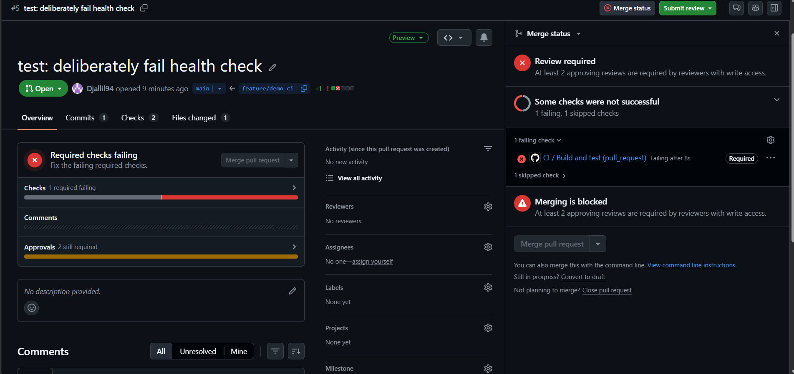
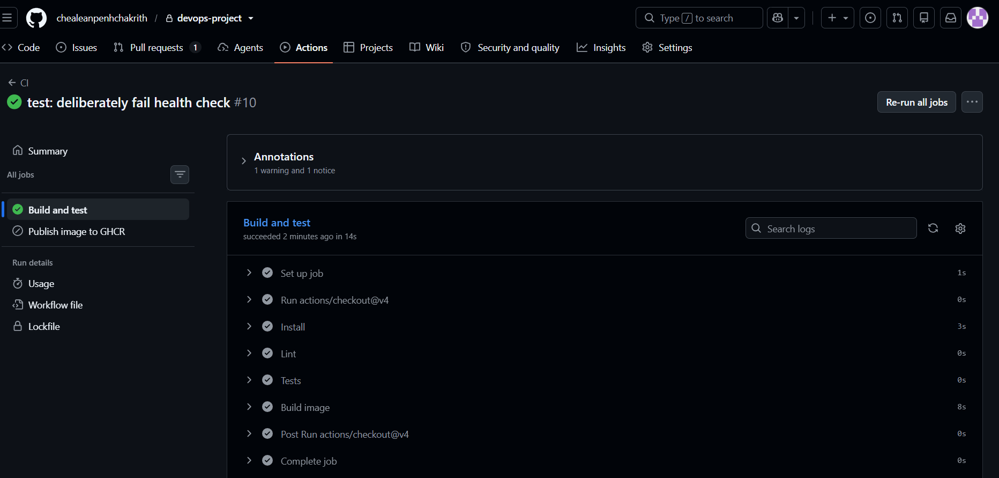

# Lab 1 - Answers to Questions 1 to 5

## Question 1 - Why forbid direct pushes to main?
Pull requests allow team members to review changes before merging them into main. This
avoid breaking the shared application and let us to trace the linked validation and 
discussion. We have to configure required checks in the branch protection settings to
enforce team to do ti.

## Question 2 - What is the difference between an image and a container?

An image is a template, it has the application, its dependencies and its runtime
configuration. A container is an instance of the image, it has its own writable
layer. Serveral containers can have the same image, and can be running or stopped
independently.

## Question 3 - Compare the image size with a non-slim base image

The sizes previously recorded for this project are:
Lightweight single-stage build: 202 MB
Lightweight multi-stage build: 199 MB
Full single-stage build: 1.58 GB

3.2

3.3

The Alpine-based image is about 87% smaller than the full image. Its base contains
fewer system packages and tools, which reduces storage and transfer requirements.
Alpine is a separate lightweight variant, rather than the official node:20-slim tag.
These sizes depend on the image versions, platform and measurement method.

Bonus: the multi-stage build saves about 3 MB in the recorded comparison. The gain
is small because the single-stage Dockerfile already installs only production
dependencies. Multi-stage builds are especially useful when compilation tools or
other build dependencies can be excluded from the final image.

## Question 4 - Why tag the image with the commit SHA rather than latest?

A commit SHA tag builds a connection between an image and a specific source revision. 
That makes it easier to trace a version through its commit, pipeline run and published 
image. And it's also easier to select a previous version for rollback. The latest can 
also point to a different version after each publication.

A SHA-based tag is a Docker tag , it can be overwritten. An image digest shows the 
exact image content; The image can be different with inputs chage on its base image,
even if we rebuild the same commit.

## Question 5 - What does fail fast mean in a pipeline?

It means being able to find a failure as early as possible and to skip subsequent steps
that depend on its succes. Cheap checks like lint and tests always be done before more 
expensive operations like building and publishing an image.

In this workflow, a failing test can stop the build image step from running, and we can 
skip the the publish job because of its failure. A failing check also stop merging if 
Build and test is configured as a required status check
on main.
